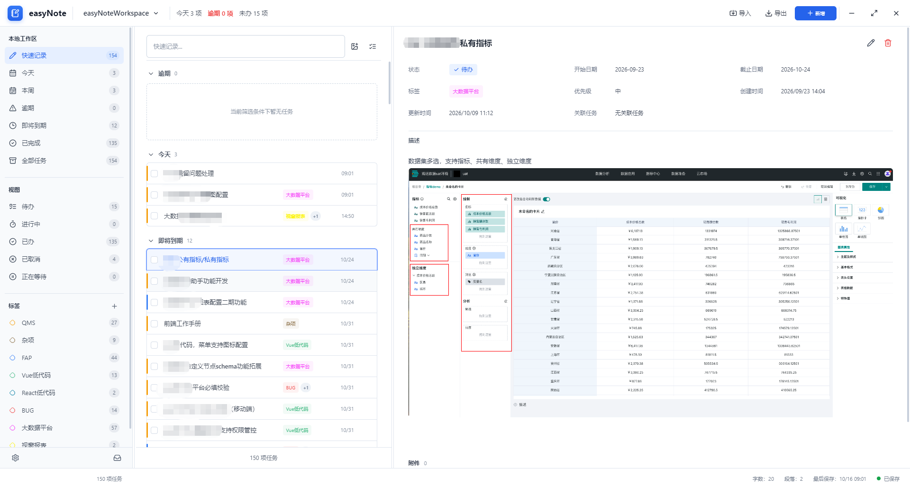
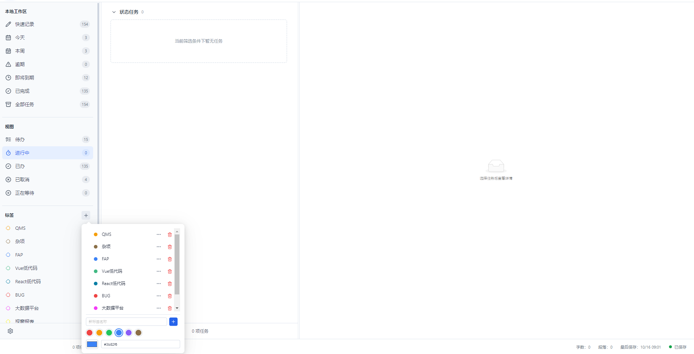
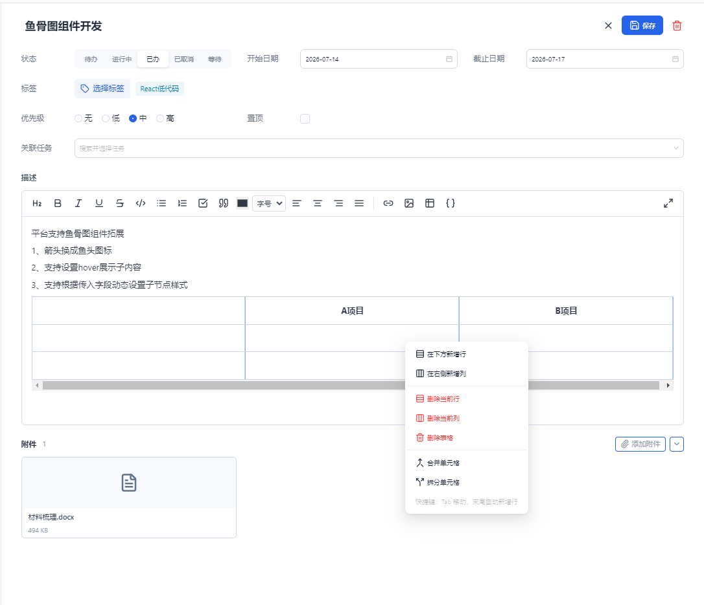

# easyNote

给自己用的 Windows 桌面任务本。一条任务里既能写下需求，也能盯着它从待办走到完成。数据放在你选定的本地文件夹里，不注册账号，也不依赖网络。

当前版本 `0.1.0`，只提供 Windows。[下载最新安装包](https://github.com/leez-bot/easyNote/releases/latest)。

## 预览

### 主界面

三栏同时摆开：左边按日期、状态和标签切换，中间是任务列表，右边是选中任务的状态、日期和正文。



### 状态、标签和空列表

点左侧的状态或标签，列表只留这一类。数量显示在每一项旁边。标签可以在这里新增、改颜色或删除。当前条件下没有任务时，中间和右侧都会空出来。



### 悬浮入口

收起主面板后，桌面上留一条置顶小条，显示今天完成了几项、有几项逾期。拖到顺手的位置，点一下再打开主面板。


### 编辑任务

点编辑后可以改状态、日期、标签、优先级和关联任务。正文里能写步骤、插表格，也可以把文件挂在附件里。



## 能做什么

**先知道今天该看什么**

- 标题栏汇总今天、逾期、未办的数量。
- 左侧按时间看：快速记录、今天、本周、逾期、即将到期、已完成、全部任务。本周会按星期分组。
- 再按状态看：待办、进行中、已办、已取消、正在等待。
- 标签自建、自选颜色。点一个标签，只看这一类；旁边的数字是该标签下的任务数。

**一条任务把需求和进度放在一起**

- 状态、优先级（无 / 低 / 中 / 高）、置顶。
- 开始日期和截止日期。逾期的未完成任务会单独冒出来。
- 一条任务可以挂多个标签。
- 关联其他任务，点标题就能跳过去。适合把一条需求拆成后续事项。
- 正文支持标题、粗体、斜体、下划线、删除线、颜色、字号、对齐、列表、任务清单、引用、代码、链接、图片和表格。图片可以直接粘贴。表格可以增删行列、合并拆分单元格、拖动列宽。编辑可以全屏。
- 附件跟任务走。图片在应用里预览，其他文件用系统默认程序打开。
- 点编辑后再保存。窗口底部显示字数、段落数和最后保存时间。

**数据留在本机，换机器也能带走**

- 第一次打开时选一个文件夹作为工作区。任务、标签、附件都写在这个目录里。
- 可以随时换成另一个工作区目录。
- 导出为一个 `.enote` 文件，里面是任务、标签和附件。
- 合并导入：把另一份数据加进当前工作区。同名标签会合并，任务 ID 冲突时会另建一条。
- 覆盖导入：先备份当前工作区，再用导入包替换现有任务。
- 可以设为开机自动启动。

## 适合谁

适合一个人记工作需求、缺陷、临时事项，并且希望过几天还能按状态或标签找回来。

目前没有账号、云同步、多人协作和权限。macOS 和 Linux 也还没有安装包。

## 开始使用

到 [Releases](https://github.com/leez-bot/easyNote/releases/latest) 下载最新的 Windows 安装包，文件名类似 `easyNote Setup 0.1.0.exe`。运行后按提示安装。如果 Windows 提示未知发布者，点「更多信息」，再选择仍要运行。当前安装包还没有代码签名证书。

也可以从源码运行。环境：Windows、Node.js、npm。

```powershell
npm install
npm run dev
```

第一次启动会要求选择工作区目录。选一个空文件夹即可，例如 `D:\Notes\easyNote`。

然后：

1. 在中间的「快速记录」里写下标题，回车会建成今天到期的任务。旁边的按钮可以改成不设日期，或在创建时顺便加一张图片。
2. 点开任务，补状态、日期、标签和正文，再点保存。
3. 左侧切换「今天」「逾期」或某个标签，确认列表会跟着变。

打包安装程序：

```powershell
npm run build:app
```

## 数据放在哪里

工作区是一个普通文件夹：

```text
<工作区>/
  workspace.json          工作区名称和元数据
  data/tasks.json         任务、标签和版本号
  attachments/<任务ID>/   复制进来的附件
  backups/                覆盖导入前的备份
  logs/
```

`.enote` 是一个 ZIP 包，内含清单、任务数据和附件目录，可以直接拷到另一台电脑再导入。应用只保存附件在工作区内的相对路径。

写入 `tasks.json` 时先写临时文件再替换，避免写到一半断电把文件写坏。从旧版本升级时，会把 v1 数据迁移到当前的 v2 结构。

## 技术栈

| | |
| --- | --- |
| 桌面壳 | Electron 33 |
| 界面 | React 18、TypeScript、Ant Design、Lucide |
| 构建 | electron-vite、Vite |
| 状态 | Zustand |
| 正文 | Tiptap |
| 导入导出 | adm-zip（`.enote`） |

界面不直接碰文件系统。渲染进程通过 preload 暴露的 `easyNoteApi` 调用主进程，再由主进程读写工作区。

常用命令：

```powershell
npm run dev        # 开发模式
npm run typecheck  # 类型检查
npm run build      # 构建 main / preload / renderer
npm run build:app  # 打包 Windows 应用
```

## 目录

```text
src/main/            窗口、工作区、任务存储、附件、导入导出
src/preload/         暴露给界面的 API
src/renderer/        React 界面
src/shared/          前后端共用的类型和 API 定义
```

## 参与

欢迎提 Issue 和 Pull Request。改界面或存储之前，先看 `AGENTS.md` 里的进程边界和数据规则。

## 许可证

[ISC License](LICENSE)。Copyright (c) 2026 lizheng。
